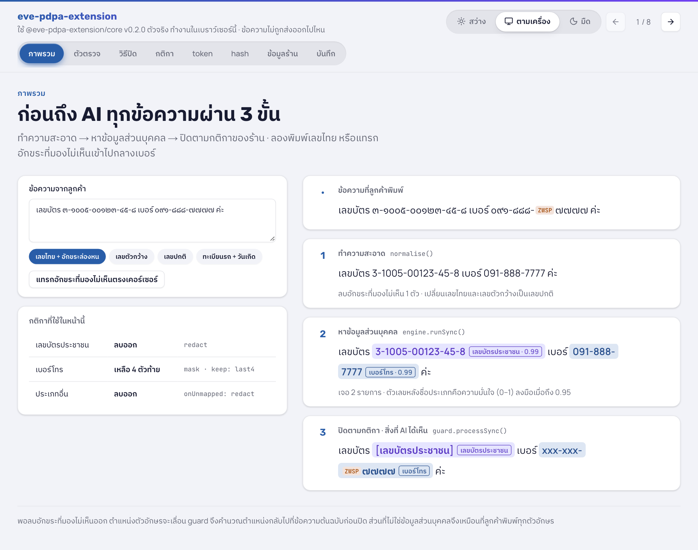

# eve-pdpa-extension

Detect and protect Thai personal data before it reaches an AI model, an AI agent, a tool, a log or a human reviewer.

[](https://github.com/mintelligence-dev/eve-pdpa-extension/actions/workflows/ci.yml)
[](LICENSE)
[](https://www.npmjs.com/package/@eve-pdpa-extension/core)
[](https://www.npmjs.com/package/@eve-pdpa-extension/cli)
[](https://www.npmjs.com/package/@eve-pdpa-extension/eve)
[](https://www.typescriptlang.org)

**English** · [ภาษาไทย](README.th.md)

<a href="https://eve-pdpa-extension.vercel.app">
  <picture>
    <source media="(prefers-color-scheme: dark)" srcset=".github/assets/demo-dark.png">
    
  </picture>
</a>

**[Try it in your browser →](https://eve-pdpa-extension.vercel.app)** The real library runs in the page. Nothing to install, and nothing you type leaves your browser.

Or deploy the example eve agent to your own Vercel account. The button asks for two keys and creates the Redis token store ([what each setting does](examples/pdpa-agent#deploy-to-vercel)):

[](https://vercel.com/new/clone?repository-url=https%3A%2F%2Fgithub.com%2Fmintelligence-dev%2Feve-pdpa-extension%2Ftree%2Fmain%2Fexamples%2Fpdpa-agent&project-name=pdpa-agent&repository-name=pdpa-agent&env=PDPA_HMAC_KEY%2CPDPA_SESSION_KEY&envDescription=Two%20different%20random%20secrets%20of%2032%20bytes%20or%20more%2C%20one%20for%20each%20key.%20Make%20each%20with%3A%20openssl%20rand%20-hex%2032&envLink=https%3A%2F%2Fgithub.com%2Fmintelligence-dev%2Feve-pdpa-extension%2Ftree%2Fmain%2Fexamples%2Fpdpa-agent%23environment-variables&stores=%5B%7B%22type%22%3A%22integration%22%2C%22integrationSlug%22%3A%22upstash%22%2C%22productSlug%22%3A%22upstash-kv%22%2C%22protocol%22%3A%22storage%22%7D%5D)

> **This is a technical tool, not a certification of compliance with Thailand's PDPA.**

## What is in this repository

| | What it is | Where it runs | Try it |
|---|---|---|---|
| [`packages/core`](packages/core) | The library your app calls on every message: detection, the six actions, tokens, audit. Zero dependencies | Node 18.18+, Deno, Bun, Cloudflare Workers, browsers | `npm install @eve-pdpa-extension/core` |
| [`packages/cli`](packages/cli) | Scans old chat exports (JSONL, CSV, LINE OA) and checks a policy file, without writing code | Node 18.18+ | `npx @eve-pdpa-extension/cli scan chats.csv` |
| [`packages/eve`](packages/eve) | An adapter for [eve](https://eve.dev) agents: wraps every channel, the model, the tools and the session | Node 24+, eve 0.80.x | `eve add` (see [Quick start](#quick-start)) |
| [`packages/middleware`](packages/middleware) | Express, Hono and Next.js middleware: hides personal data in a chat request body before your handler runs, and checks a JSON reply on the way out | Node 18.18+, Deno, Bun, Cloudflare Workers | Not on npm yet · coming in 0.3 |
| [`packages/mcp`](packages/mcp) | An MCP server with `pdpa_scan` and `pdpa_redact`, so an AI agent (Claude Code, Claude Desktop, Cursor) can find and hide personal data before text leaves it | Node 20+ | Not on npm yet |
| [`examples/pdpa-agent`](examples/pdpa-agent) | A complete eve agent for a Thai shop, set up with `eve add` | Your machine, or Vercel | `npm run dev` · [deploy your own](examples/pdpa-agent#deploy-to-vercel) |
| [`apps/demo`](apps/demo) | The live demo, built with Next.js and [Mintel UI](https://mintel-ui.vercel.app) | Your browser | [eve-pdpa-extension.vercel.app](https://eve-pdpa-extension.vercel.app) |

All of them detect and mask with the same code in `packages/core`.

## How it works

A guard sits between your customers and the AI, on your own server:

```
customer ──▶ clean up ──▶ detect ──▶ settle overlaps ──▶ act per policy ──▶ AI sees [tok:…]
                                                                              │
     tool allowed by the policy  ◀── swap the token for the real value ◀─────┤
                                                                              ▼
customer sees xxx-xxx-7777  ◀────────────── check the reply ◀────────── AI answers [tok:…]

                   every step writes an audit event, never the value itself
```

1. **Clean up.** Thai and full-width digits become ordinary digits, and invisible characters hidden inside a number are removed. Positions are mapped back, so everything else stays exactly as the customer typed it.
2. **Detect.** Twelve types: national ID, phone, email, bank account, credit card, LINE user ID, license plate, date of birth, passport number, PromptPay ID, address and person name. Each match has a confidence score. Checksums (mod-11, Luhn), patterns and cue words such as "เบอร์" or "บัญชี" decide it. No AI is involved and nothing goes over the network.
3. **Settle overlaps.** When two matches overlap they are hidden together as one span, so no value is ever left half covered.
4. **Act per policy.** One JSON file says what happens to each type: `redact`, `mask`, `tokenise`, `hash`, `flag` or `block`.
5. **Tokens.** A tool can swap a token back for the real value, but only for a purpose the policy allows, in the same chat, before it expires. A reply has its tokens shown masked to the customer.
6. **Audit.** Every scan, every token swap and every policy load is recorded. A record never holds a real value.

## Safeguards

| Rule | How it is enforced |
|---|---|
| No real values in audit | An audit event records the type, position and action, never the matched text. `sessionId` and `ref` are stored as you pass them, so do not use a phone number or LINE userId for them. |
| Real values only where allowed | `guard.resolve()` swaps a token only for a purpose listed in the policy's `allowedPurposes`, in the token's own session, within `ttlSec` (at most 3600 s). In eve, only tools wrapped with `pdpa.tool()` can resolve. |
| Customers never see tokens | Outbound (`boundary: 'outbound'`) turns this chat's tokens into masked values such as `xxx-xxx-7777`, and any other token into a placeholder. |
| Blocked text does not leak | `block` always returns `text: ''`, so forgetting to check `outcome` still sends nothing. |
| A broken token store fails closed | If tokens cannot be stored, the message is blocked rather than passed through. |
| core cannot reach the network | No dependencies, no `node:` builtins, no network calls. Enforced by `pnpm gates` and a Deno smoke test run with no permissions. |
| No real data in the repo | Every file under `fixtures/` must be listed in `fixtures/ATTESTATION.md` as synthetic. |

## Quick start

### Protect an eve agent

Needs Node 24 or later and an eve 0.80.x agent (`npx eve@0.80.1 init my-agent`).

```bash
eve add https://cdn.jsdelivr.net/npm/@eve-pdpa-extension/eve@0.2.0/r/pdpa.json --overwrite
```

This writes a policy, wraps the channel and adds the session hook. Then wrap your model in `agent/agent.ts` and set two keys. The [eve README](packages/eve/README.md#install-in-3-steps) has the three steps; [`examples/pdpa-agent`](examples/pdpa-agent) is a finished agent made exactly this way.

Or deploy that example agent to your own Vercel account in one click. It asks for the two keys, creates the Redis token store and explains each variable [in its README](examples/pdpa-agent#deploy-to-vercel):

[](https://vercel.com/new/clone?repository-url=https%3A%2F%2Fgithub.com%2Fmintelligence-dev%2Feve-pdpa-extension%2Ftree%2Fmain%2Fexamples%2Fpdpa-agent&project-name=pdpa-agent&repository-name=pdpa-agent&env=PDPA_HMAC_KEY%2CPDPA_SESSION_KEY&envDescription=Two%20different%20random%20secrets%20of%2032%20bytes%20or%20more%2C%20one%20for%20each%20key.%20Make%20each%20with%3A%20openssl%20rand%20-hex%2032&envLink=https%3A%2F%2Fgithub.com%2Fmintelligence-dev%2Feve-pdpa-extension%2Ftree%2Fmain%2Fexamples%2Fpdpa-agent%23environment-variables&stores=%5B%7B%22type%22%3A%22integration%22%2C%22integrationSlug%22%3A%22upstash%22%2C%22productSlug%22%3A%22upstash-kv%22%2C%22protocol%22%3A%22storage%22%7D%5D)

### Use the library in your own code

```bash
npm install @eve-pdpa-extension/core
```

```ts
import { readFileSync } from 'node:fs'
import { createGuard, parsePolicy } from '@eve-pdpa-extension/core'

const guard = createGuard({
  policy: parsePolicy(readFileSync('pdpa-policy.json', 'utf8')),
  hmacKey: process.env.PDPA_HMAC_KEY, // openssl rand -hex 32
  onAudit: (event) => console.log(JSON.stringify(event)),
})

const inbound = await guard.process('เบอร์ ๐๙๑-๘๘๘-๗๗๗๗ ค่ะ', { sessionId: 'conv_8f2a' })
inbound.text // 'เบอร์ [tok:rfdbkfrtnsmbvpsh] ค่ะ'  ← what the AI sees
```

Run the guard **on the server only**: anyone can read a key or a token that is in the browser. The full flow, with a tool resolving the token and the reply masked, is in core's [Quick start](packages/core/README.md#quick-start).

### Scan old chat exports

```bash
npx @eve-pdpa-extension/cli scan chats.csv
```

It reports what personal data the file holds, per type and line, and never prints a value. See the [cli README](packages/cli/README.md).

## Known limits

- Names and addresses are found only when something points to them: a name needs a title (นาย, นางสาว, a rank, Mr, Dr …), an introduction ("ผมชื่อ", "my name is"), a form label, or to be the answer to a question that asked for one · an address must hold three kinds of part (house number, soi, tambon, amphoe, province, postcode), or two with a word such as "ที่อยู่" or "address" · a bare name in the middle of a sentence, a nickname, and a place named with no labels are not found (that needs NER).
- Bank accounts, phone numbers without a leading 0, license plates, dates of birth and passport numbers need a cue word such as "เลขบัญชี" or "วันเกิด", or the other side's question passed as `context`.
- eve: only **eve 0.80.x** is supported; eve 1.x, which `npm install eve` gives today, is not yet. eve's HTTP channel is not masked on the way out.
- Accuracy figures come from synthetic data, so they are an upper bound, not what you will see in production.

The full lists are under Known limitations in the [core](packages/core/README.md#known-limitations) and [eve](packages/eve/README.md#known-limitations) READMEs.

## Roadmap

No versions are promised, and the order may change.

- **eve 1.x.**
- **Masking eve's HTTP channel on the way out.**
- **Policy files from disk** (`@eve-pdpa-extension/policy`): YAML and full validation. Node only, so it stays out of the zero-dependency core.
- **Name detection with an NER model** (`@eve-pdpa-extension/ner`), kept out of core because a model is hundreds of MB. No model is chosen yet; every candidate's licence has to be checked first.

## Repository layout

```
packages/core/       @eve-pdpa-extension/core   zero deps · every runtime · 150 KB size budget
packages/cli/        @eve-pdpa-extension/cli    Node only
packages/eve/        @eve-pdpa-extension/eve    eve adapter: channel · tool · model · outbound · hook
packages/http/       @eve-pdpa-extension/http   gateway · not on npm · deployed with a Deploy to Vercel button
packages/middleware/ @eve-pdpa-extension/middleware   Express · Hono · Next.js · not on npm yet (0.3)
packages/mcp/        @eve-pdpa-extension/mcp    MCP server · pdpa_scan · pdpa_redact · stdio · not on npm yet
apps/demo/           the live demo · Next.js + Mintel UI · a static export, hosted on Vercel
examples/            pdpa-policy.json, an example policy · pdpa-agent/, a runnable eve agent
bench/               chat templates and the accuracy harness · generated data stays out of git
internal/            4 consumer fixtures proving the exports map works
scripts/             gates enforcing core's constraints · smoke tests on 5 runtimes
```

## Development

Needs Node 22.19+ or 24.5+, and pnpm through corepack.

| Command | |
|---|---|
| `corepack pnpm install` | Install the repo's dependencies |
| `corepack pnpm exec playwright install chromium` | Once · used by the browser smoke test |
| `corepack pnpm verify` | lint · build · typecheck · test · gates · size · smoke on 5 runtimes · README examples |
| `corepack pnpm demo` | Run the live demo at http://localhost:3000 |
| `node bench/generate.mjs --holdout` | Generate the holdout set (never used to tune the detectors) · run `pnpm build` first |
| `node bench/evaluate.mjs --holdout --context` | Measure accuracy · writes a report to `bench/out/` |

TypeScript · pnpm workspaces · tsdown · Vitest · Biome · size-limit · Playwright · Next.js · smoke tests on Node, Deno, Bun, workerd and Chromium.

## Contributing

Issues and pull requests are welcome. Make sure `corepack pnpm verify` passes before opening a pull request. **Never commit real personal data**, not in tests, fixtures, issues or commit messages. See [CONTRIBUTING.md](CONTRIBUTING.md) for all the rules, [CODE_OF_CONDUCT.md](CODE_OF_CONDUCT.md), and [SECURITY.md](SECURITY.md) to report a vulnerability privately.

## Credits

The demo is built with [Mintel UI](https://github.com/mintelligence-dev/mintel-magicui), M Intelligence's open-source design system.

## License

[MIT](LICENSE). Copyright (c) 2026 M Intelligence.
Versions already published under Apache-2.0 (core 0.1.0, cli 0.1.0, eve 0.1.0 and 0.1.1) stay under it, as released.
