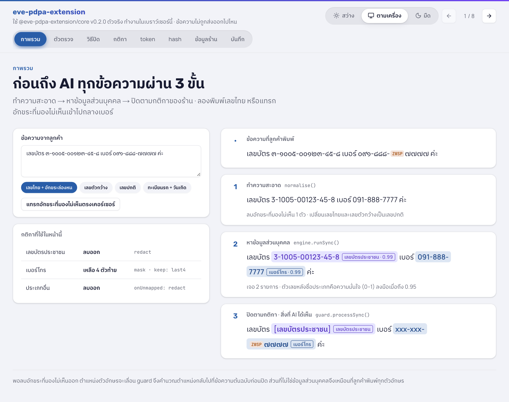

# eve-pdpa-extension

ตรวจจับและปิดข้อมูลส่วนบุคคลไทยในข้อความ ก่อนส่งต่อให้ AI model, AI agent, tool, log หรือคนรีวิว

[](https://github.com/mintelligence-dev/eve-pdpa-extension/actions/workflows/ci.yml)
[](LICENSE)
[](https://www.npmjs.com/package/@eve-pdpa-extension/core)
[](https://www.npmjs.com/package/@eve-pdpa-extension/cli)
[](https://www.npmjs.com/package/@eve-pdpa-extension/eve)
[](https://www.typescriptlang.org)

[English](README.md) · **ภาษาไทย**

<a href="https://eve-pdpa-extension.vercel.app">
  <picture>
    <source media="(prefers-color-scheme: dark)" srcset=".github/assets/demo-dark.png">
    
  </picture>
</a>

**[ลองใช้ในเบราว์เซอร์ →](https://eve-pdpa-extension.vercel.app)** ไลบรารีตัวจริงทำงานอยู่ในหน้าเว็บ ไม่ต้องติดตั้ง และข้อความที่พิมพ์ไม่ถูกส่งออกไปไหน

หรือ deploy eve agent ตัวอย่างขึ้น Vercel ของคุณเอง ปุ่มจะให้กรอก key 2 ตัว แล้วสร้าง Redis สำหรับเก็บ token ให้ ([ค่าแต่ละตัวทำอะไร](examples/pdpa-agent#deploy-to-vercel))

[](https://vercel.com/new/clone?repository-url=https%3A%2F%2Fgithub.com%2Fmintelligence-dev%2Feve-pdpa-extension%2Ftree%2Fmain%2Fexamples%2Fpdpa-agent&project-name=pdpa-agent&repository-name=pdpa-agent&env=PDPA_HMAC_KEY%2CPDPA_SESSION_KEY&envDescription=Two%20different%20random%20secrets%20of%2032%20bytes%20or%20more%2C%20one%20for%20each%20key.%20Make%20each%20with%3A%20openssl%20rand%20-hex%2032&envLink=https%3A%2F%2Fgithub.com%2Fmintelligence-dev%2Feve-pdpa-extension%2Ftree%2Fmain%2Fexamples%2Fpdpa-agent%23environment-variables&stores=%5B%7B%22type%22%3A%22integration%22%2C%22integrationSlug%22%3A%22upstash%22%2C%22productSlug%22%3A%22upstash-kv%22%2C%22protocol%22%3A%22storage%22%7D%5D)

> **เป็นเครื่องมือทางเทคนิค ไม่ใช่ใบรับรองการปฏิบัติตาม พ.ร.บ.คุ้มครองข้อมูลส่วนบุคคล**

## ใน repository นี้มีอะไร

| | คืออะไร | ใช้ที่ไหน | ลองใช้ |
|---|---|---|---|
| [`packages/core`](packages/core) | ไลบรารีที่แอปเรียกกับทุกข้อความ: ตรวจหา ปิด 6 แบบ token และบันทึก ไม่มี dependency | Node 18.18+, Deno, Bun, Cloudflare Workers, browser | `npm install @eve-pdpa-extension/core` |
| [`packages/cli`](packages/cli) | ตรวจไฟล์แชทเก่า (JSONL, CSV, LINE OA) และตรวจไฟล์กติกา โดยไม่ต้องเขียนโค้ด | Node 18.18+ | `npx @eve-pdpa-extension/cli scan chats.csv` |
| [`packages/eve`](packages/eve) | ตัวห่อ agent ที่สร้างด้วย [eve](https://eve.dev): ห่อทุก channel, โมเดล, tool และ session | Node 24+, eve 0.80.x | `eve add` (ดู[เริ่มใช้งาน](#เริ่มใช้งาน)) |
| [`packages/middleware`](packages/middleware) | middleware สำหรับ Express, Hono และ Next.js: ปิดข้อมูลส่วนบุคคลใน body ของ request แชทก่อนถึง handler และตรวจคำตอบแบบ JSON ก่อนส่งออก | Node 18.18+, Deno, Bun, Cloudflare Workers | ยังไม่อยู่บน npm · จะมาใน 0.3 |
| [`examples/pdpa-agent`](examples/pdpa-agent) | eve agent ร้านค้าตัวอย่างที่ติดตั้งด้วย `eve add` รันได้จริง | เครื่องของคุณ หรือ Vercel | `npm run dev` · [deploy ของคุณเอง](examples/pdpa-agent#deploy-to-vercel) |
| [`apps/demo`](apps/demo) | หน้า live demo สร้างด้วย Next.js และ [Mintel UI](https://mintel-ui.vercel.app) | เบราว์เซอร์ | [eve-pdpa-extension.vercel.app](https://eve-pdpa-extension.vercel.app) |

ทุกตัวใช้โค้ดตรวจและปิดชุดเดียวกันใน `packages/core`

## ทำงานอย่างไร

guard เป็นด่านที่คั่นระหว่างลูกค้ากับ AI ทำงานบน server ของร้านเอง

```
ลูกค้า ──▶ ทำความสะอาด ──▶ ตรวจหา ──▶ ตัดสินจุดที่ซ้อน ──▶ ปิดตามกติกา ──▶ AI เห็น [tok:…]
                                                                          │
     tool ที่กติกาอนุญาต  ◀── แลก token เป็นค่าจริง ◀────────────────────┤
                                                                          ▼
ลูกค้าเห็น xxx-xxx-7777  ◀──────────── ตรวจคำตอบขาออก ◀──────────── AI ตอบ [tok:…]

               ทุกขั้นเขียนบันทึก (audit) โดยไม่มีค่าจริงอยู่ข้างใน
```

1. **ทำความสะอาด** เปลี่ยนเลขไทยและเลขตัวกว้างเป็นเลขปกติ ลบอักขระที่มองไม่เห็นที่แทรกอยู่ในตัวเลข แล้วคำนวณตำแหน่งกลับ ส่วนอื่นของข้อความจึงเหมือนที่ลูกค้าพิมพ์ทุกตัวอักษร
2. **ตรวจหา** 9 ประเภท: เลขบัตรประชาชน, เบอร์โทร, อีเมล, เลขบัญชี, บัตรเครดิต, LINE user ID, ทะเบียนรถ, วันเกิด และเลขพาสปอร์ต แต่ละรายการมีค่าความมั่นใจ ตัดสินด้วยหลักตรวจ (mod-11, Luhn) รูปแบบ และคำบอกใบ้อย่าง "เบอร์" หรือ "บัญชี" ไม่ใช้ AI และไม่ออกเน็ต
3. **ตัดสินจุดที่ซ้อนกัน** ถ้าสองรายการทับกัน จะปิดรวมเป็นช่วงเดียว ไม่มีค่าไหนถูกปิดครึ่งๆ กลางๆ
4. **ปิดตามกติกา** ไฟล์ JSON ไฟล์เดียวบอกว่าเจอแต่ละประเภทแล้วให้ทำอะไร: `redact`, `mask`, `tokenise`, `hash`, `flag` หรือ `block`
5. **token** tool แลก token กลับเป็นค่าจริงได้เฉพาะ purpose ที่กติกาอนุญาต ในห้องแชทเดียวกัน และก่อนหมดอายุ ส่วนคำตอบที่ส่งถึงลูกค้า token จะแสดงเป็นแบบปิด
6. **บันทึก** ทุกครั้งที่ตรวจ แลก token และโหลดกติกา จะถูกบันทึก แต่ในบันทึกไม่มีค่าจริง

## หลักความปลอดภัย

| กฎ | บังคับใช้อย่างไร |
|---|---|
| บันทึกไม่มีค่าจริง | บันทึกเก็บแค่ประเภท ตำแหน่ง และสิ่งที่ทำ ไม่เก็บข้อความที่ตรวจเจอ ส่วน `sessionId` และ `ref` ถูกเก็บตามที่ส่งมา จึงไม่ควรใช้เบอร์หรือ LINE userId เป็นค่าพวกนี้ |
| ค่าจริงไปถึงเฉพาะที่อนุญาต | `guard.resolve()` แลก token ได้เฉพาะ purpose ที่อยู่ใน `allowedPurposes` ในห้องแชทของ token นั้น และก่อนครบ `ttlSec` (สูงสุด 3600 วินาที) ใน eve มีแค่ tool ที่ห่อด้วย `pdpa.tool()` ที่แลกได้ |
| ลูกค้าไม่เห็น token | ขาออก (`boundary: 'outbound'`) แปลง token ของห้องนี้เป็นค่าที่ปิดแล้ว เช่น `xxx-xxx-7777` ส่วน token อื่นกลายเป็นชื่อประเภท |
| ข้อความที่ถูก block ไม่หลุด | `block` คืน `text: ''` เสมอ ถึงจะลืมเช็ค `outcome` ข้อความก็ไม่ถูกส่งต่อ |
| ที่เก็บ token พัง ข้อความไม่หลุด | ถ้าเก็บ token ไม่ได้ ข้อความจะถูกบล็อกแทนการปล่อยผ่าน |
| core ออกเน็ตไม่ได้ | ไม่มี dependency ไม่ใช้ `node:` builtin และไม่เรียก network บังคับด้วย `pnpm gates` และ smoke test บน Deno ที่ไม่ให้ permission ใดๆ |
| ไม่มีข้อมูลจริงใน repo | ทุกไฟล์ใน `fixtures/` ต้องลงชื่อใน `fixtures/ATTESTATION.md` ว่าเป็นข้อมูลสังเคราะห์ |

## เริ่มใช้งาน

### ห่อ agent ที่สร้างด้วย eve

ต้องใช้ Node 24 ขึ้นไป และ agent บน eve 0.80.x (`npx eve@0.80.1 init my-agent`)

```bash
eve add https://cdn.jsdelivr.net/npm/@eve-pdpa-extension/eve@0.2.0/r/pdpa.json --overwrite
```

คำสั่งนี้เขียนไฟล์กติกา ห่อ channel และเพิ่ม hook ให้ จากนั้นห่อโมเดลใน `agent/agent.ts` และตั้ง key 2 ตัว ขั้นตอนครบอยู่ใน [README ของ eve](packages/eve/README.th.md#ติดตั้งใน-3-ขั้น) และ [`examples/pdpa-agent`](examples/pdpa-agent) คือ agent ที่ทำตามขั้นตอนนี้จนเสร็จ

หรือ deploy agent ตัวอย่างนั้นขึ้น Vercel ของคุณด้วยปุ่มเดียว ปุ่มจะให้กรอก key 2 ตัว สร้าง Redis สำหรับเก็บ token ให้ และอธิบายตัวแปรแต่ละตัวไว้[ใน README ของตัวอย่าง](examples/pdpa-agent#deploy-to-vercel)

[](https://vercel.com/new/clone?repository-url=https%3A%2F%2Fgithub.com%2Fmintelligence-dev%2Feve-pdpa-extension%2Ftree%2Fmain%2Fexamples%2Fpdpa-agent&project-name=pdpa-agent&repository-name=pdpa-agent&env=PDPA_HMAC_KEY%2CPDPA_SESSION_KEY&envDescription=Two%20different%20random%20secrets%20of%2032%20bytes%20or%20more%2C%20one%20for%20each%20key.%20Make%20each%20with%3A%20openssl%20rand%20-hex%2032&envLink=https%3A%2F%2Fgithub.com%2Fmintelligence-dev%2Feve-pdpa-extension%2Ftree%2Fmain%2Fexamples%2Fpdpa-agent%23environment-variables&stores=%5B%7B%22type%22%3A%22integration%22%2C%22integrationSlug%22%3A%22upstash%22%2C%22productSlug%22%3A%22upstash-kv%22%2C%22protocol%22%3A%22storage%22%7D%5D)

### ใช้ไลบรารีในโค้ดของคุณเอง

```bash
npm install @eve-pdpa-extension/core
```

```ts
import { readFileSync } from 'node:fs'
import { createGuard, parsePolicy } from '@eve-pdpa-extension/core'

const guard = createGuard({
  policy: parsePolicy(readFileSync('pdpa-policy.json', 'utf8')),
  hmacKey: process.env.PDPA_HMAC_KEY, // openssl rand -hex 32
  onAudit: (event) => console.log(JSON.stringify(event)),
})

const inbound = await guard.process('เบอร์ ๐๙๑-๘๘๘-๗๗๗๗ ค่ะ', { sessionId: 'conv_8f2a' })
inbound.text // 'เบอร์ [tok:rfdbkfrtnsmbvpsh] ค่ะ'  ← สิ่งที่ AI เห็น
```

รัน guard **ฝั่ง server เท่านั้น** เพราะ key และ token ที่อยู่ในเบราว์เซอร์ใครก็อ่านได้ ตัวอย่างเต็ม (tool แลก token และปิดคำตอบขาออก) อยู่ใน[เริ่มใช้ของ core](packages/core/README.th.md#เริ่มใช้)

### ตรวจไฟล์แชทเก่า

```bash
npx @eve-pdpa-extension/cli scan chats.csv
```

รายงานว่าไฟล์มีข้อมูลส่วนบุคคลประเภทไหน อยู่บรรทัดไหน โดยไม่พิมพ์ค่าจริงออกมา ดู [README ของ cli](packages/cli/README.th.md)

## ข้อจำกัด

- ยังไม่ตรวจชื่อคนและที่อยู่ ดู[แผนงาน](#แผนงาน)
- เลขบัญชี เบอร์ที่ไม่มี 0 นำหน้า ทะเบียนรถ วันเกิด และเลขพาสปอร์ต ต้องมีคำบอกใบ้ เช่น "เลขบัญชี" "วันเกิด" หรือส่งคำถามของอีกฝ่ายมาเป็น `context`
- eve: รองรับเฉพาะ **eve 0.80.x** ยังไม่รองรับ eve 1.x ที่ `npm install eve` ให้มาตอนนี้ และ HTTP channel ของ eve ยังไม่ถูกปิดตอนขาออก
- ตัวเลขความแม่นยำวัดจากข้อมูลสังเคราะห์ จึงเป็นค่าสูงสุดที่ทำได้ ไม่ใช่ค่าที่จะเจอจริง

รายการเต็มอยู่ในหัวข้อข้อจำกัดของ [core](packages/core/README.th.md#ข้อจำกัดที่รู้อยู่) และ [eve](packages/eve/README.th.md#ข้อจำกัดที่ควรรู้)

## แผนงาน

ยังไม่มีกำหนดเวอร์ชัน ลำดับอาจเปลี่ยนได้

- **ชื่อคน ที่อยู่ และพร้อมเพย์** มีโค้ดอยู่บน branch `feat/promptpay` แล้ว รอรีวิว
- **eve 1.x**
- **ปิดข้อมูลขาออกของ HTTP channel** ใน eve
- **โหลดกติกาจากไฟล์** (`@eve-pdpa-extension/policy`) อ่าน YAML และตรวจเต็มรูปแบบ ใช้ได้เฉพาะ Node จึงแยกจาก core ที่ไม่มี dependency
- **MCP server** (`@eve-pdpa-extension/mcp`) มี tool `pdpa.scan` และ `pdpa.redact` ให้ AI agent เรียกใช้
- **ตรวจชื่อด้วยโมเดล NER** (`@eve-pdpa-extension/ner`) แยกจาก core เพราะโมเดลใหญ่หลายร้อย MB ยังไม่ได้เลือกโมเดล ต้องตรวจ license ก่อน

## โครงสร้าง repository

```
packages/core/       @eve-pdpa-extension/core   ไม่มี dependency · ใช้ได้ทุก runtime · งบขนาด 150 KB
packages/cli/        @eve-pdpa-extension/cli    Node เท่านั้น
packages/eve/        @eve-pdpa-extension/eve    ตัวห่อ eve: channel · tool · model · ขาออก · hook
packages/http/       @eve-pdpa-extension/http   gateway · ยังไม่อยู่บน npm · deploy ด้วยปุ่ม Deploy to Vercel
packages/middleware/ @eve-pdpa-extension/middleware   Express · Hono · Next.js · ยังไม่อยู่บน npm (0.3)
apps/demo/           หน้า live demo · Next.js + Mintel UI · static export บน Vercel
examples/            pdpa-policy.json กติกาตัวอย่าง · pdpa-agent/ eve agent ที่รันได้
bench/               ข้อความตัวอย่างและชุดวัดความแม่นยำ · ข้อมูลที่สร้างไม่อยู่ใน git
internal/            โปรเจกต์ทดสอบการ import 4 แบบ
scripts/             ตัวตรวจข้อบังคับของ core · smoke test บน 5 runtime
```

## การพัฒนา

ต้องใช้ Node 22.19+ หรือ 24.5+ และ pnpm ผ่าน corepack

| คำสั่ง | |
|---|---|
| `corepack pnpm install` | ติดตั้ง dependency ของ repo |
| `corepack pnpm exec playwright install chromium` | ครั้งเดียว · ใช้ใน smoke test ของ browser |
| `corepack pnpm verify` | lint · build · typecheck · test · gates · size · smoke 5 runtime · ตัวอย่างใน README |
| `corepack pnpm demo` | เปิดหน้า live demo ที่ http://localhost:3000 |
| `node bench/generate.mjs --holdout` | สร้างชุด holdout (ชุดที่ไม่ได้ใช้ปรับตัวตรวจ) · ต้อง `pnpm build` ก่อน |
| `node bench/evaluate.mjs --holdout --context` | วัดความแม่นยำ · เขียนรายงานที่ `bench/out/` |

## ร่วมพัฒนา

ยินดีรับ issue และ pull request ก่อนส่ง PR ให้รัน `corepack pnpm verify` ให้ผ่าน **ห้าม commit ข้อมูลส่วนบุคคลจริง** ทั้งในเทสต์ fixture issue และ commit message ดูกฎทั้งหมดใน [CONTRIBUTING.md](CONTRIBUTING.md) และ [CODE_OF_CONDUCT.md](CODE_OF_CONDUCT.md) · แจ้งช่องโหว่แบบส่วนตัวตาม [SECURITY.md](SECURITY.md)

## ขอบคุณ

หน้า demo สร้างด้วย [Mintel UI](https://github.com/mintelligence-dev/mintel-magicui) design system แบบ open source ของ M Intelligence

## สัญญาอนุญาต

[MIT](LICENSE) · Copyright (c) 2026 M Intelligence
นำไปใช้ แก้ไข และใช้เชิงพาณิชย์ได้ ต้องคงข้อความลิขสิทธิ์และสัญญาอนุญาตไว้ ซอฟต์แวร์นี้ให้ "ตามสภาพ" ไม่มีการรับประกันใดๆ
เวอร์ชันที่ออกภายใต้ Apache-2.0 ไปแล้ว (core 0.1.0 · cli 0.1.0 · eve 0.1.0 และ 0.1.1) ยังเป็น Apache-2.0 ตามที่ออก
